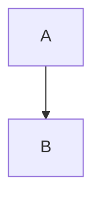

# fastedit

A small, fast text editor. This file is a golden highlighting sample.

Inline markup: **strong**, _emphasis_, `code`, ,
<https://fastedit.dev>, <kbd>Ctrl</kbd> and a \*literal\* star.

## Getting started

Install the toolchain, then build:

```sh
rustup toolchain install
cargo run --release -- README.md
```

Setext headings work too
------------------------

> Block quotes can hold *emphasis*, `code` and [links](https://example.com).
> They continue on the next line.

### Features

- Syntax highlighting for 17 languages
- Soft wrap and folding
  - nested list item
  - another one
- [x] Golden tests
- [ ] Language injections

1. Open a file
2. Edit it
3. Save it

    Indented code block
    with two lines

Hard break at the end of this line  
and a [reference link][docs].

[docs]: https://example.com/docs "Documentation"

| Key       | Action        |
|-----------|---------------|
| `cmd-p`   | Open palette  |
| `cmd-s`   | Save          |

<details>
<summary>HTML blocks pass through</summary>

Hidden content.

</details>

***

~~~rust
fn main() {
    println!("tildes fence code too");
}
~~~

Final paragraph with a footnote-like marker[^1].


