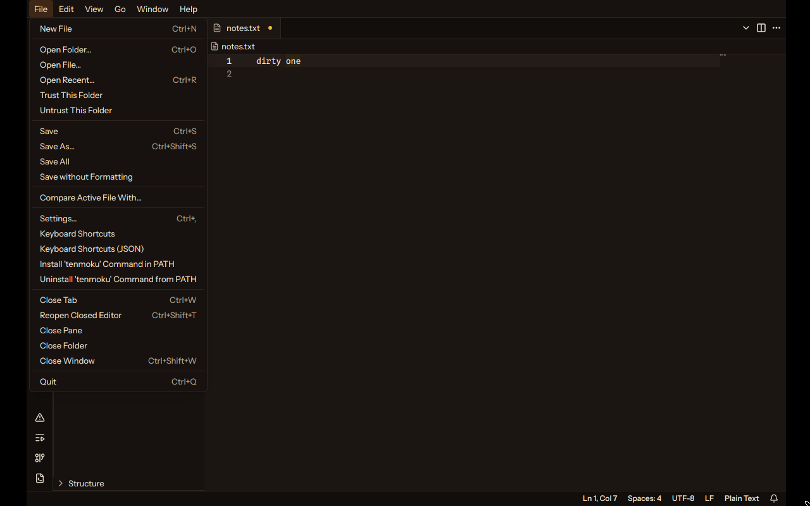
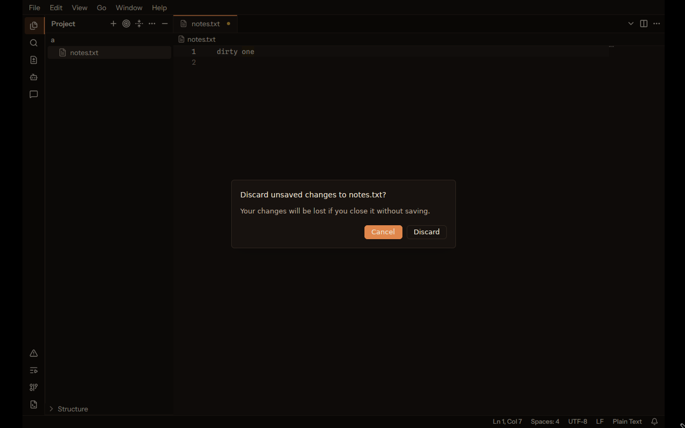
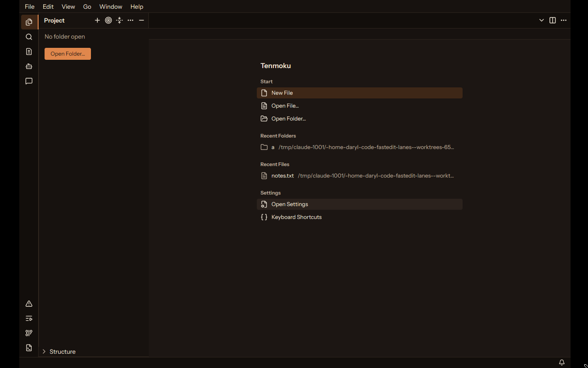
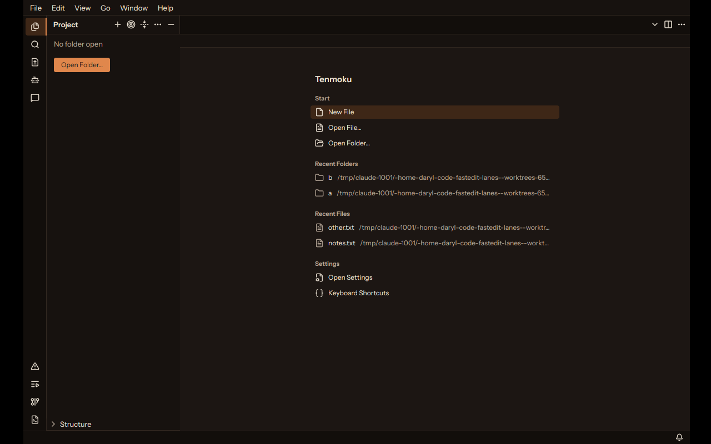

# File > Close Folder (T687, Mac T1943)

`workbench.close_folder` (palette and File menu: Close Folder; key
`secondary-k f`, cmd-k f / ctrl-k f, in the workbench) closes every tab of
every pane, pinned ones too, then leaves the window with no folder.

## How it closes

- The tabs close through `kiln_shell::close::confirm` as Close All Editors
  does (`close_many.rs`, now `Workbench::close_tabs` shared by both): an
  unsaved tab asks **Discard unsaved changes to …? Cancel / Discard**, the
  same prompt Close All Editors shows (C2's "Save / Don't Save / Cancel"
  wording doesn't match that prompt; the test follows "as Close All Editors
  does"). Cancel keeps the folder and every tab. A root that changes while
  the prompt is up keeps its folder.
- Then `Workbench::close_root` runs the rootless half of `set_root`
  (`re_root`, their shared body): new `ProjectPanel`/`GitPanel`/quick open
  with no root, the old git state closed and a rootless one made, search and
  nav set to no root (`set_root` there takes `Option<PathBuf>` now), no root
  settings watch, trust resolved for no root, toolbars and the title with no
  root, the layout's root none. New terminal sessions start in the home
  folder (`terminal_dir` with no root); one running stays.
- It emits `RootClosed` (re-exported from the crate). `lsp.rs` makes a new,
  rootless manager on it as on `RootChanged`, so the root's servers shut
  down. Nothing is recorded in Open Recent; the folder stays there.
- With no folder open the command does nothing.

## Restore

`LayoutKeys::save` writes `"root": ""` for a window with no root, so
`entry_root` doesn't reopen it on its store's (launch) root; `reopen.rs`
already reads an empty root as no folder. A folder launch on the folder
restores that store's windows on the folder, as before.

## What the other root followers keep

They follow `RootChanged`, which a close doesn't emit:

- `debug_panel`: keeps following the old root's breakpoint store until the
  next re-root.
- `chat_panel` and `plugin_host`: follow `TrustChanged` too, which resolving
  trust for no root emits, so they re-read the workspace then.
- `settings_editor` and `markdown_preview`: they are tabs, and every tab
  closes.
- The app's per-window settings (`fastedit/src/main.rs` `watch_window`) keep
  the old root's project settings until the next re-root.
- The branch, stash and harpoon pickers, which dismiss on `RootChanged`,
  stay open if one is up (close_root dismisses only the root's palettes).

## Real app (C7)

Checked on Linux with run-fastedit-linux (Xvfb, xdotool), its own config
and state folders:

1. Launched on folder `a`, trusted it, opened `notes.txt` and typed into
   it. File menu: Close Folder between Close Pane and Close Window, with no
   key shown (a chord, as Close Pane's):
   
2. File > Close Folder asks about the unsaved file (Discard / Cancel, the
   Close All Editors prompt):
   
3. Discard: the Start page and No folder open show; `notes.txt` on disk is
   unchanged; `a` stays in Recent Folders:
   
4. Quit (ctrl+q), launched on folder `b`, opened `other.txt`, pressed
   ctrl-k f: the same, with nothing to ask:
   
5. Quit (ctrl+q), relaunched with no argument: one window, no folder:
   
