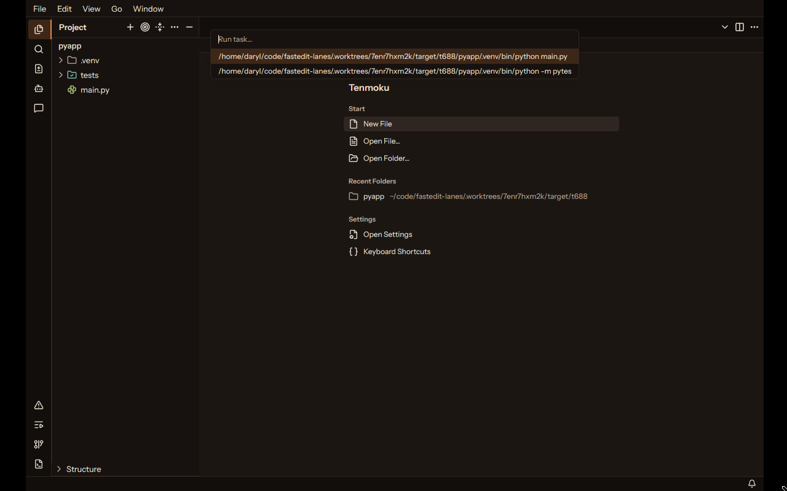
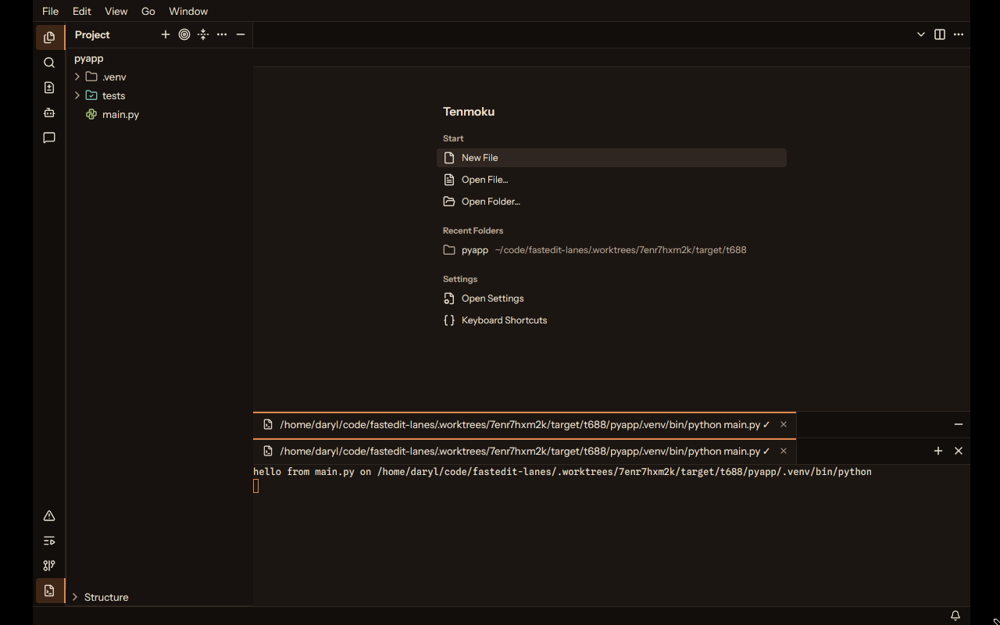
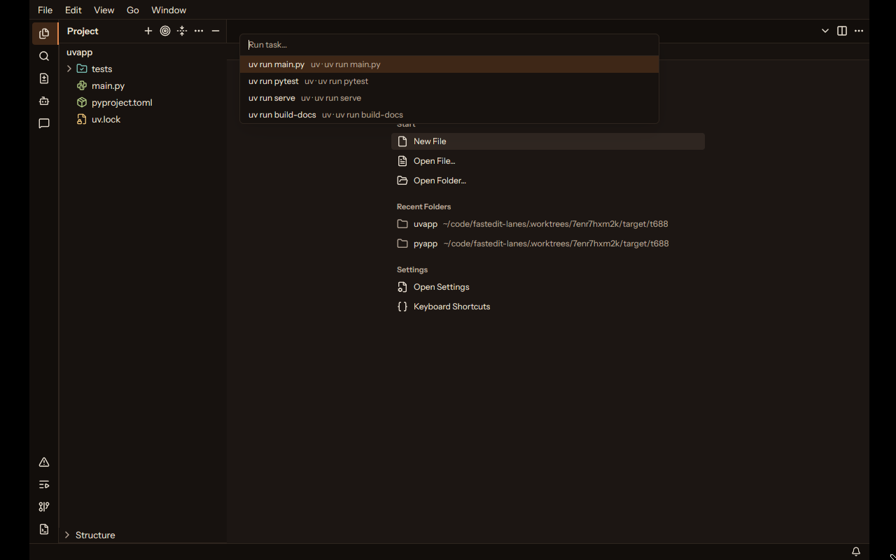
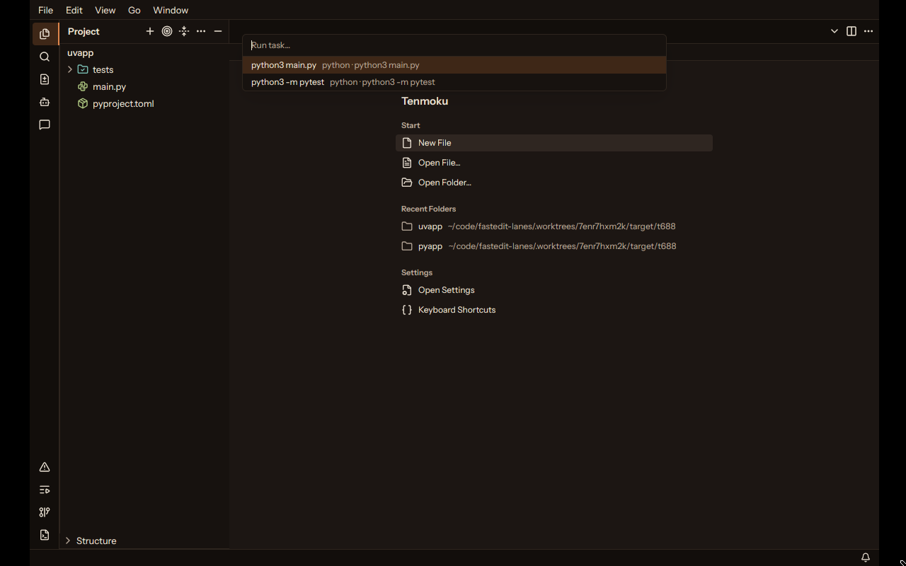

# Python tasks in Run Task… (T688)

A Linux tester's Python project (`main.py`, a `.venv`, no `pyproject.toml`)
showed "No tasks: add .tenmoku/tasks.toml". Detection now covers Python;
see the Detection list in `crates/fe-workbench/src/task_defs.rs`.

## What's detected

- A root is a Python project when it has `main.py`, `pyproject.toml`,
  `setup.py`, `requirements.txt` or `uv.lock`. A `.venv`, `tests/` or
  `conftest.py` alone isn't enough: plenty of other projects have a `tests/`.
- The interpreter is `fe_dap::registry::python_interpreter(root, None, …)`,
  the one the debugger picks: `<root>/.venv/bin/python`, else `python3`
  (`python` on Windows). It's on its full path, so the task doesn't depend on
  the task runner's working directory resolving a relative program.
- `<python> main.py` (group run), `<python> -m pytest` (group test, the
  group's default by name when nothing earlier gives one), and each
  `[project.scripts]` name as `<root>/.venv/bin/<name>` when that file is
  there. A script that isn't installed isn't listed: there's nothing to run.
- With a `uv.lock` at the root, all of them go through uv instead:
  `uv run main.py`, `uv run pytest`, `uv run <name>` (Source::Uv). Whether
  `uv` is installed isn't checked: running it says so, as `npm run` does for
  a missing npm.
- Script names keep the file's order. The `toml` crate here sorts a table's
  keys (no `preserve_order`), so the names are read as `toml::Spanned` keys and
  put back in the order of their spans. Names with a path separator, `.` or
  `..` are skipped, so neither `uv run` nor the `.venv` lookup leaves the
  scripts.
- `[tool:pytest]` in `setup.cfg` is found as pytest's `iniconfig` reads the
  file: a header at the start of a line, with `#` or `;` starting a comment
  after it (`[tool:pytest] # settings` counts; an indented line doesn't).
- A `pyproject.toml` that doesn't parse leaves just the file-based tasks
  (main.py, pytest by files).

Run Task… rereads on changes to those files at the root, to `tests/`
(anything under it), and to `.venv`, `.venv/bin` and the files directly in
`.venv/bin`. Changes deeper in `.venv` (site-packages) don't reread: a
`pip install` touches thousands of files there.

## Checked in the real Linux app

Built with `driver.sh build` at 35af44292 and driven under Xvfb
(run-fastedit-linux), with scratch projects made in the lane worktree's
`target/` folder.

A project with `main.py`, a `.venv` made by `python3 -m venv`, `tests/test_x.py`
and no tasks file: after Trust Folder, Run Task… lists the `.venv` python's
main.py and pytest tasks.

The row's label is the whole command, interpreter path included, so on a
deep root the `python · …` detail runs past the edge of the list here. The
list was 600 px wide; the rows below show the detail where labels are short.

Running the main.py task opens its terminal with the script's output, printed
by the `.venv` interpreter:

A uv project (`uv.lock`, `pyproject.toml` with scripts `serve` and
`build-docs`, `main.py`, `tests/test_y.py`) lists the uv run tasks, scripts in
the file's order, with `uv` as their source. **uv is not installed on this
host** (`command -v uv` finds nothing), so these were listed but not run.

With `uv.lock` moved away while the app ran, Run Task… lists `python3 main.py`
and `python3 -m pytest` with `python` as their source; the scripts go, as
there's no `.venv` holding them.

pytest itself isn't installed in the scratch `.venv`, so the pytest task
wasn't run; it's listed because the project has tests.
