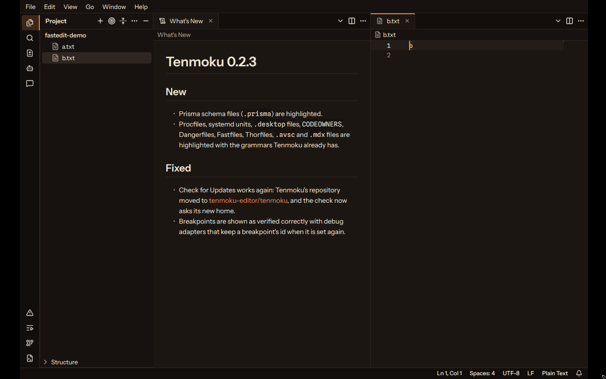

# T685 Open to the Side: real-app check

Linux app under Xvfb: right-click b.txt shows Open (Enter) and Open to the Side (Ctrl+Enter);
choosing Open to the Side splits right and shows b.txt in the new focused pane, the left pane keeps its tab.

